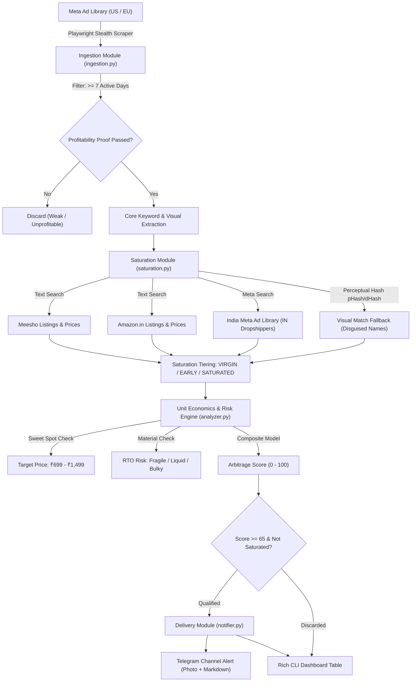

# E-Commerce Trend Arbitrage & Market Saturation Engine

A production-grade, modular Python automation engine designed to detect active, winning dropshipping products in Western markets (US/EU/CA/AU), cross-verify whether they are already saturated in India (**Meesho**, **Amazon.in**, and **India Meta Ad Library**), compute India Cash-on-Delivery (COD) unit economics & RTO risk, and push qualified high-margin opportunities directly to a Telegram channel.

---

## 🏗️ Architecture Overview



---

## 📁 Directory Structure

```text
ecommerce_trend_arbitrage/
├── .env.example             # Environment variables template
├── requirements.txt         # Pinned production dependencies
├── README.md                # System documentation & operational guide
├── config.py                # Pydantic-based configuration management
├── models.py                # Typed Pydantic data schemas for pipeline entities
├── ingestion.py             # Western Meta Ad Library scraper with longevity filter
├── saturation.py            # Multi-channel India market checker (Meesho, Amazon, Meta India)
├── analyzer.py              # Unit economics, sweet-spot pricing, RTO risk & 0-100 scoring
├── notifier.py              # Telegram photo/markdown dispatcher & Rich terminal dashboard
├── main.py                  # Async pipeline orchestrator with concurrency & backoff
└── utils/
    ├── __init__.py
    ├── browser.py           # Playwright manager with stealth, UA pool & evasions
    ├── image_matcher.py     # Perceptual hash (dHash + pHash) visual matcher
    └── keyword_extractor.py # Regex/NLP cleaner for product names and hooks
```

---

## ⚡ Quick Setup Instructions

### 1. Prerequisites
- **Python**: Version 3.10, 3.11, or 3.12 installed.
- **Node/Chromium**: Required for Playwright stealth rendering.

### 2. Clone / Navigate to Directory
```bash
cd C:\Users\Sarb\.gemini\antigravity\scratch\ecommerce_trend_arbitrage
```

### 3. Create & Activate Virtual Environment (Recommended)
```bash
python -m venv venv

# On Windows:
.\venv\Scripts\activate

# On Linux / macOS:
source venv/bin/activate
```

### 4. Install Dependencies & Playwright Browser Binaries
```bash
pip install -r requirements.txt
playwright install chromium
```

### 5. Setup Environment Variables
Copy the `.env.example` file to `.env`:
```bash
cp .env.example .env
```
Open `.env` and configure your Telegram credentials (optional for dry-runs):
```ini
TELEGRAM_BOT_TOKEN="123456789:ABCdefGHIjklMNOpqrsTUVwxyz"
TELEGRAM_CHAT_ID="@your_dropshipping_channel"
TELEGRAM_ENABLED=true
```

---

## 🚀 Execution & Usage

### 1. Run in Demo Mode (Simulates Western Ad Feed with Real Verification)
Runs the full pipeline using pre-validated winning dropshipping ad fixtures to verify Meesho, Amazon, economics, and Telegram dispatch:
```bash
python main.py --demo
```

### 2. Run Live Scrape (Meta Ad Library US/EU)
Scrapes active ads matching configured dropshipping trigger keywords (`"50% off free shipping"`, `"get yours today"`, etc.):
```bash
python main.py --countries US,GB,CA --min-days 7 --limit 15
```

### 3. Dry-Run Mode (Print Rich Tables without Sending Telegram Messages)
```bash
python main.py --demo --dry-run
```

### 4. Custom Keyword & Concurrency Overrides
```bash
python main.py --keywords "sunset lamp,mini food chopper,crystal hair eraser" --concurrency 4 --headless
```

### Command-Line Arguments Reference:
| Flag | Type | Default | Description |
|---|---|---|---|
| `--keywords` | `str` | `settings.AD_KEYWORDS` | Comma-separated search queries for ad feeds |
| `--countries` | `str` | `"US,GB,CA,AU"` | Comma-separated ISO country codes |
| `--min-days` | `int` | `7` | Strict minimum consecutive running days |
| `--limit` | `int` | `10` | Max candidate ads to ingest and evaluate |
| `--concurrency` | `int` | `3` | Max concurrent worker tasks for market checks |
| `--headless` | `bool` | `True` | Run Chromium headless |
| `--dry-run` | `flag` | `False` | Run analysis without sending Telegram alerts |
| `--demo` | `flag` | `False` | Test full pipeline with winning product fixtures |

---

## 🧠 Core Methodology & Business Logic

### 1. Proof of Profitability (Longevity Filter)
- Unprofitable ads are killed by dropshippers within 48 to 72 hours.
- Any ad actively running for **>= 7 consecutive days** indicates positive return on ad spend (ROAS).
- Ads active for **>= 30 days** represent high-scale 7-figure flagship winners.

### 2. India Saturation Tiers
| Tier | Meesho Listings | India Meta Ads | Opportunity Level |
|---|---|---|---|
| **VIRGIN** | 0 - 2 | 0 | **Ultra High Priority** (Blue ocean; zero competition) |
| **EARLY** | 3 - 8 | < 3 | **Moderate Priority** (Valid demand, low ad competition) |
| **SATURATED** | > 8 | >= 3 | **Discard** (Discounter price war underway) |

### 3. Visual Match Fallback (pHash / dHash)
Indian marketplace sellers frequently disguise viral dropshipping items under generic names (e.g., *"Modern Home Projector Gadget"* instead of *"Sunset Lamp"*).
The `image_matcher.py` module computes 64-bit DCT perceptual hash (`pHash`) and gradient difference hash (`dHash`) against marketplace candidate thumbnails:
$$\text{Similarity} = 1.0 - \frac{0.6 \times \text{Hamming}(\text{pHash}_1, \text{pHash}_2) + 0.4 \times \text{Hamming}(\text{dHash}_1, \text{dHash}_2)}{64}$$
Matches with similarity **$\ge 0.80$** are recognized as identical products regardless of title variation.

### 4. Unit Economics & RTO Risk Filtering
- **Sweet Spot Retail Price:** ₹699 to ₹1,499.
  - Below ₹699: Shipping (₹90) + Ad CPA (₹260) erodes profit to zero.
  - Above ₹1,499: Impulse conversion drops; COD return rates surge above 35%.
- **Return-To-Origin (RTO) Penalties:**
  - **Fragile Items** (glass, mirrors, ceramics) $\rightarrow$ Penalized by -20 pts due to high transit damage.
  - **Liquids / Cosmetics** (serums, lotions) $\rightarrow$ Penalized by courier spill policies & compliance hurdles.
  - **Bulky / Overweight** $\rightarrow$ Excessive volumetric reverse-logistics courier charges.

### 5. Arbitrage Score (0 - 100 Formula)
$$\text{Score} = \text{Longevity}(35) + \text{MarketGap}(40) + \text{SweetSpot}(15) + \text{MarginSpread}(10) - \text{RTORiskPenalty}(20)$$
A score $\ge 65$ qualifies the product for immediate Telegram delivery.

---

## 📱 Telegram Alert Format

```markdown
🔥 E-COM ARBITRAGE OPPORTUNITY FOUND 🔥
━━━━━━━━━━━━━━━━━━━━━━━━━━
📦 Product: Sunset Projection Lamp
🎯 Arbitrage Score: 85.0 / 100  |  💎 Tier: VIRGIN
🛡️ RTO Risk: 🟢 LOW

🇺🇸 Western Market Traction (US):
• Active Running: 24 consecutive days (Proof of Profitability)
• Creative: [View Meta Ad Creative](https://www.facebook.com/ads/library/?id=948271049281)
• Store: [Storefront Link](https://trendglowstore.com/products/sunset-lamp)

🇮🇳 India Saturation Check:
• Meesho Listings: 1 (₹450 - ₹599)
• Amazon.in Listings: 2 (Avg ₹699)
• Active India Meta Ads: 0
• Saturation Status: 🌟 VIRGIN OPPORTUNITY: Only 1 Meesho listing and 0 active India ads.

💰 Unit Economics (Sweet Spot: ₹699 - ₹1,499):
• Recommended Selling Price: ₹899
• Est. Sourcing Cost: ₹198
• Est. Shipping + COD RTO Buffer: ₹125
• Est. Meta CPA: ₹260
• Projected Net Margin: 35.2%
━━━━━━━━━━━━━━━━━━━━━━━━━━
```


---

## ☁️ Deploying to Render (24/7 Cloud Hosting)

This bot is pre-configured for **Render** (render.com) using Microsoft's official Playwright Docker image and an integrated HTTP health check endpoint on `$PORT` (10000).

### Method A: 1-Click Render Blueprint (Recommended)

1. Push this repository to GitHub (e.g. `ecommerce-trend-arbitrage`).
2. Open your [Render Dashboard](https://dashboard.render.com/) -> **New** -> **Blueprint**.
3. Select your GitHub repository. Render reads `render.yaml` automatically.
4. Fill in your environment variables:
   - `TELEGRAM_BOT_TOKEN`: Your Telegram Bot API token
   - `TELEGRAM_CHAT_ID`: Your authorized Telegram Chat ID
5. Click **Apply**. Render builds the Playwright Docker container and launches the bot 24/7!

### Method B: Manual Web Service Setup

1. In [Render Dashboard](https://dashboard.render.com/), click **New** -> **Web Service**.
2. Connect your GitHub repository.
3. Configure the service:
   - **Environment**: `Docker`
   - **Dockerfile Path**: `./Dockerfile`
   - **Instance Type**: `Free`
4. Under **Environment Variables**, add:
   - `TELEGRAM_BOT_TOKEN`: `your_bot_token`
   - `TELEGRAM_CHAT_ID`: `your_chat_id`
   - `TELEGRAM_ENABLED`: `true`
   - `HEADLESS`: `true`
   - `PORT`: `10000`
5. Click **Deploy Web Service**.
6. Render will automatically detect the internal health check server on port 10000 (`GET /`) and keep the bot running.
